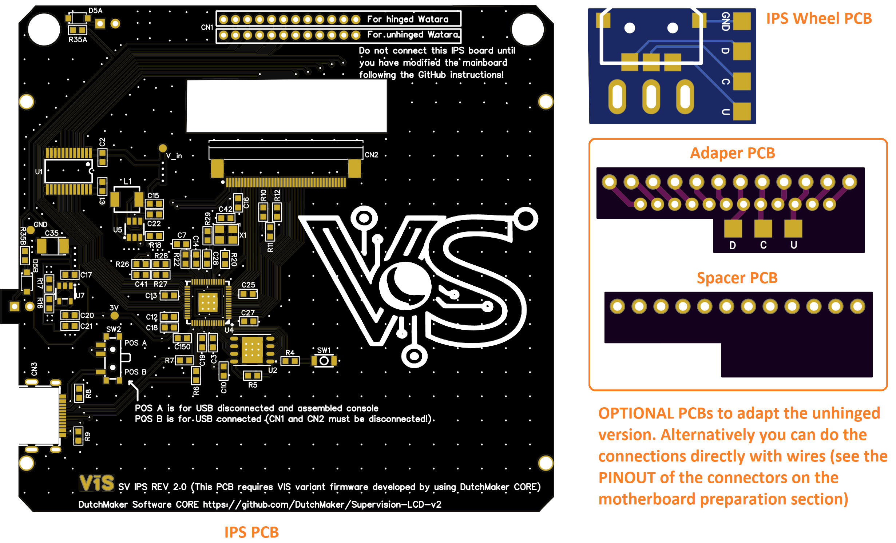

[Back to homepage](README.md)

 

## General components that can be purchased on several shops

- ER-TFT3.92-1 Display ([Datasheet](https://www.buydisplay.com/download/manual/ER-TFT3.92-1_Datasheet.pdf)) See more details on the [Original DutchMaker Project](https://github.com/DutchMaker/Supervision-LCD-v2)
- 10 cm x 10 cm x 0.6mm Transparent Acrylic Sheet (if you plan to make the screen lens yourself)
- Brackets (3D printed) 
- IPS wheel (surface-mount navigation switch) Mfr. Part # COM-08184 ([Aliexpress](https://www.aliexpress.com/item/4000697123862.html))
- SS8550 PNP transistor (replaces Q1 on the mainboard). Check the pinout of your part before soldering: it is usually E-B-C (flat side facing you, leads down), like the original S9015, but some variants have a different pin order.
- Ceramic capacitors (OPTIONAL to refresh the OEM ones): 22 pF COG (x2), 4.7 uF, 100 nF (x8), 2.2 nF (x2)
- Electrolytic capacitors (OPTIONAL to refresh the OEM ones): 220 uF 16v, 33 uF 25v (x5)
- B203 potentiometer (if you want to replace the OEM)
- 4 MHz quartz (if you want to replace the OEM)
- Audio Jack (if you want to replace the OEM) Mfr. Part # PJ-307 (LCSC code C22355760)
- Breakable male PIN headers for the optional PCBs. You need 2 mm  ([Aliexpress](https://www.aliexpress.com/item/1005007078061569.html)) and 2.5 mm ([Aliexpress](https://www.aliexpress.com/item/1005008703085861.html)) pitch

## Bill of Materials (IPS BOARD)

| Reference Designators    | Description  | Mfr. Part # | LCSC code | 
| ----------------------- | --------------------------------------------------------------------- | --------------------- | --------------------- |
| R4, R26, R29 | 1 kΩ 0603 resistor   | RT0603FRE131KL         | C5220830 |
| R5, R10, R11, R12, R20, R22 | 10 kΩ 0603 resistor   | RC0603FR-0710KL         | C98220 |
| R6, R7 | 27 Ω 0603 resistor   | RC0603FR-0727RL         | C137753 |
| R8, R9, R27, R28 | 5.1 kΩ 0603 resistor   | RC0603FR-075K1L         | C105580 |
| R16 | 47 kΩ 0603 resistor   | RC0603FR-0747KL         | C105579 |
| R17 | 33 kΩ 0603 resistor   | RC0603FR-0733KL         | C126359 |
| R18 | 5.1 Ω 0603 resistor   | AC0603FR-075R1L        | C227988 |
| R35A, R35B | 2 kΩ 0603 resistor   |  AC0603DR-072KL        | C227483 |
| C1, C2, C3, C7, C10, C12, C13, C14, C18, C19, C21, C25, C27, C28, C41, C42 | 100 V 100 nF 0603 capacitor   | GCJ188R72A104KA01D          | C161117 |
| C15, C150 | 16 V 1 μF 0603 capacitor   | GRM188R71C105KE15D          | C77049 |
| C16, C17, C20 | 10 V 10 μF 0603 capacitor   | GRM188R61A106KE69D          | C77044 |
| C22 | 10 V 220 nF 0603 capacitor   | GCM188R71H224KA64D          | C97857 |
| C35 | 6.3 V 220 μF tantalum capacitor   | 6TPE220MAZB          | C79111 |
| CN1 | 12 pins female connector 2 mm pitch | -          | [Aliexpress](https://www.aliexpress.com/item/1005010405571178.html) |
| CN2 | 40 pins connector 0.5 mm pitch | 05A20L40P          | C5362161 |
| CN3 | USB-C connector  | TPS16-N1F1-2016-A          | C22357897 |
| D5A, D5B | Zener diode  | MMSZ5227BT1G        | C154803 |
| L1 | 1.2 A 22 μH Inductor  | APH0420T220M        | C5349666 |
| U1 | Logic converter   | SN74LVC8T245PWR        | C27643 |
| U2 | 16 Mbit  memory   | W25Q16JVZPIQ        | C377853 |
| U4 | RP2040   | RP2040 or SC0914(13)        | C3227924 or C2040 |
| U5 | Boost converter   | AP3019AKTR-G1        | C44956 |
| U7 | LDO   | SPX3819M5-L/TR        | C9056 |
| X1 |  Crystal   | OT2EL89CJI-111YLC-12M        | C5280582 |
| POWER LED RED | 3 mm red LED (cloudy lens)   | MHL3014SRTS          | C397053 |
| B_LED, C_LED | 0603 blue LED   | 19-217/BHC-ZL1M2RY/6T          | C2986058 |
| SW1 | 3x2 mm tactile switch | 1TS015A-2000-0600-CT        | C256106 |
| SW2 |  switch   | SSSS811101        | C109335 |

[Back to homepage](README.md)

