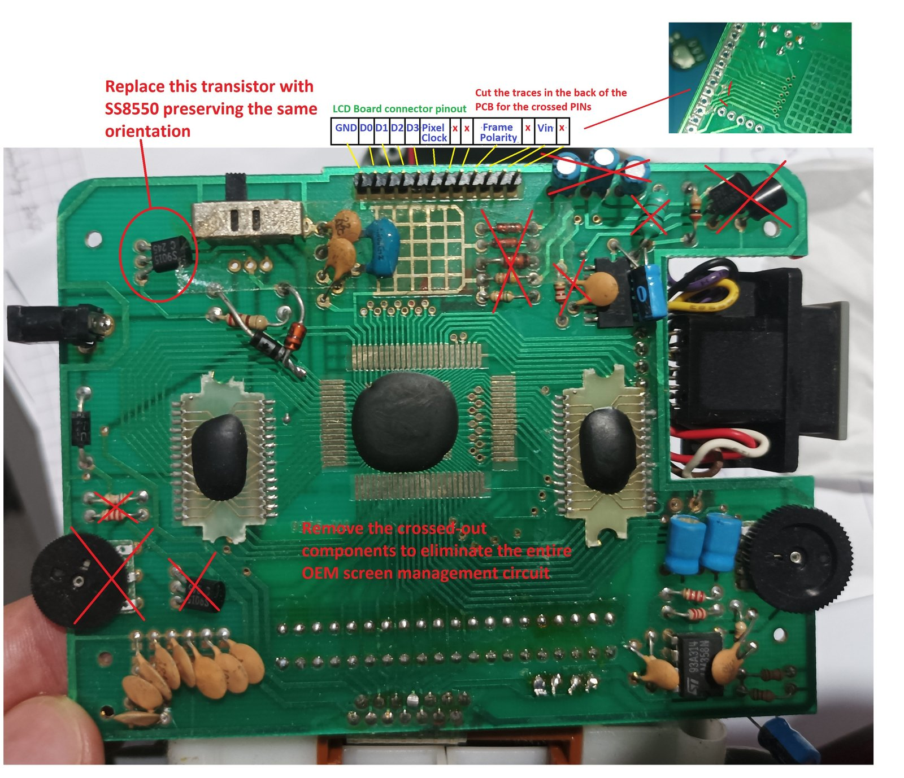
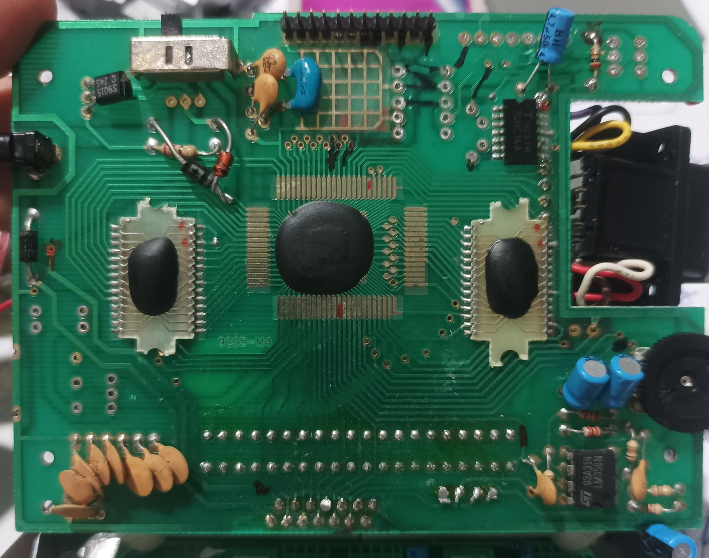
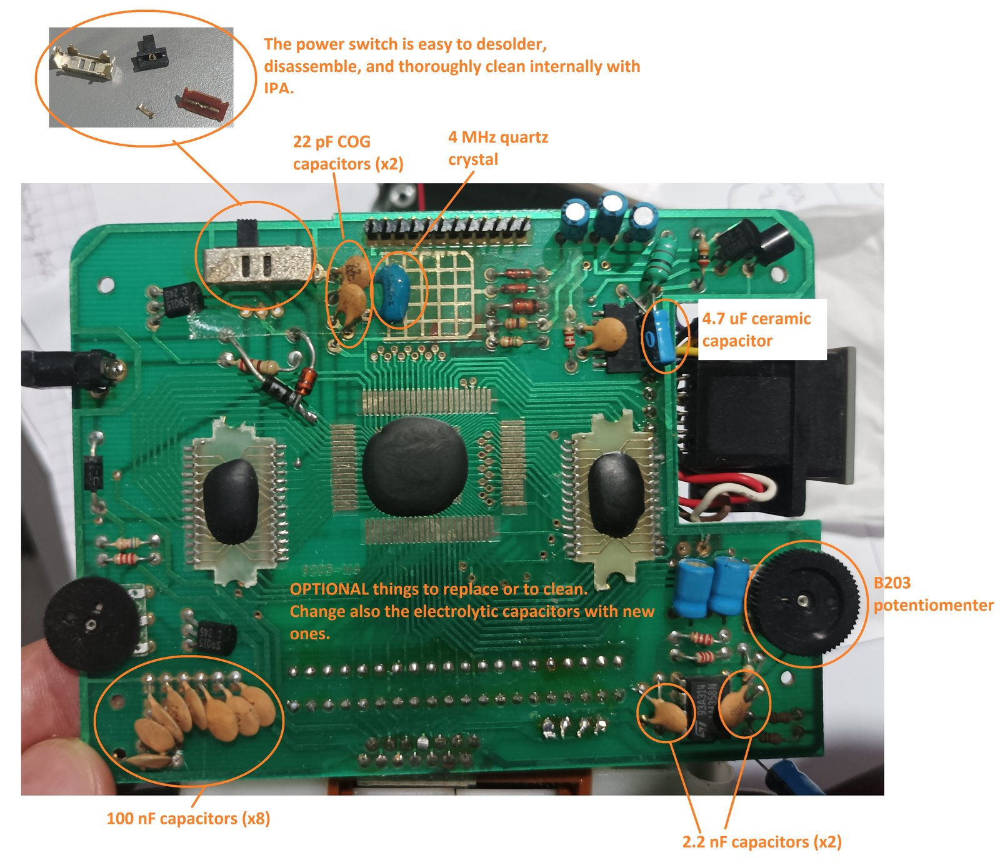
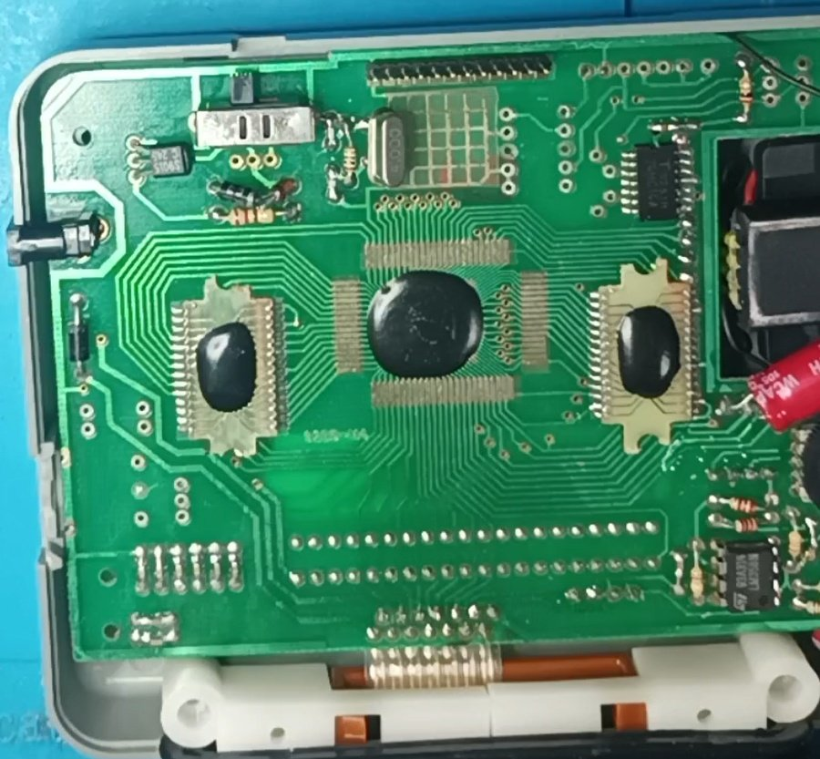
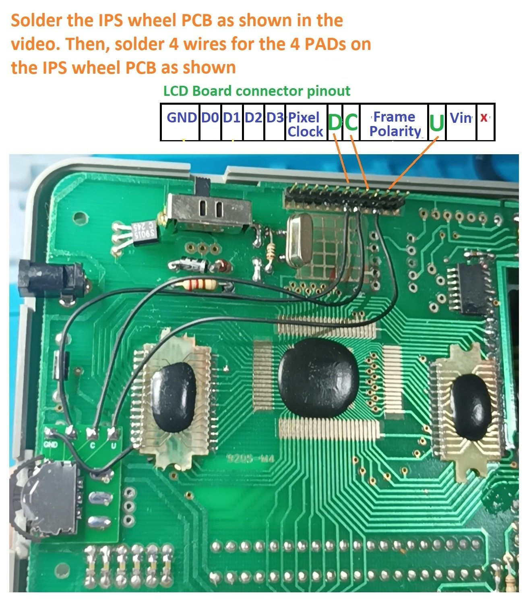

[Back to homepage](README.md)

# Board preparation: Hinged version
Components to desolder (**required step**):

 
Result:

 
Components to be refreshed (**optional step**).

 
Result:

 
Final step: solder the IPS wheel PCB (and the 4 wires as shown).

[Back to homepage](README.md)

