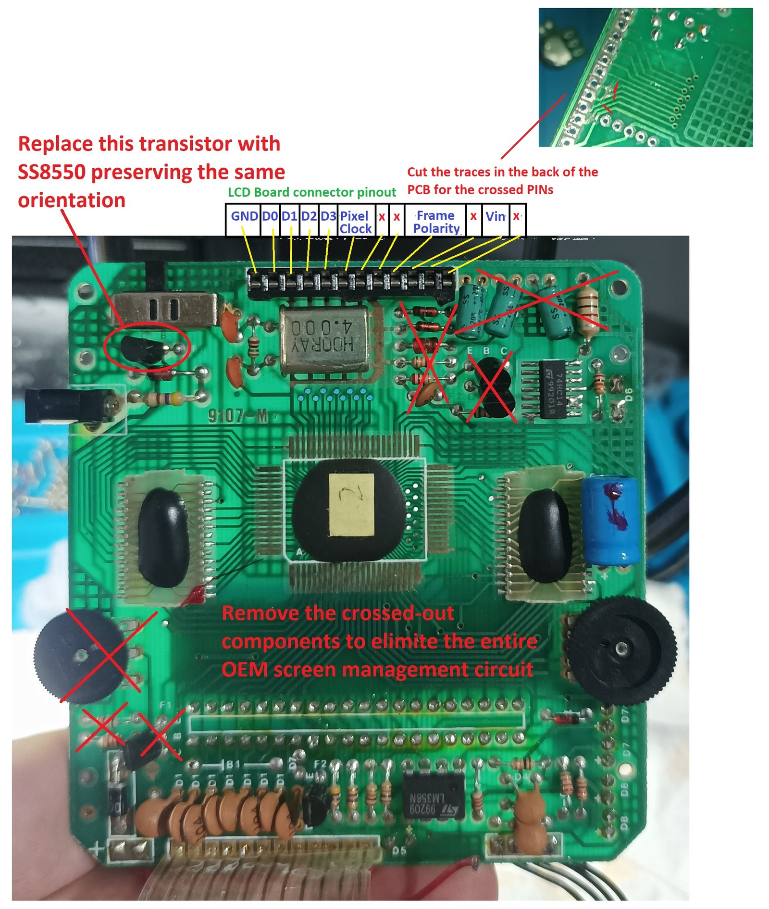
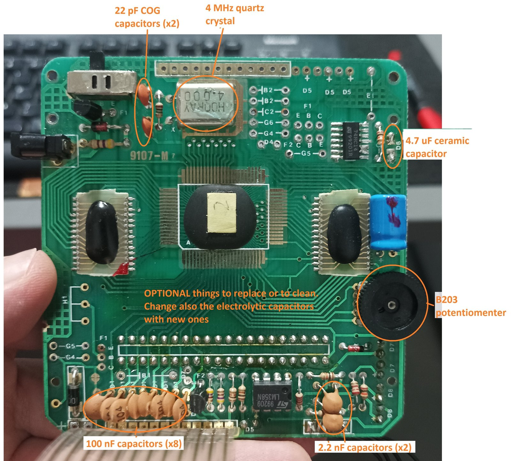
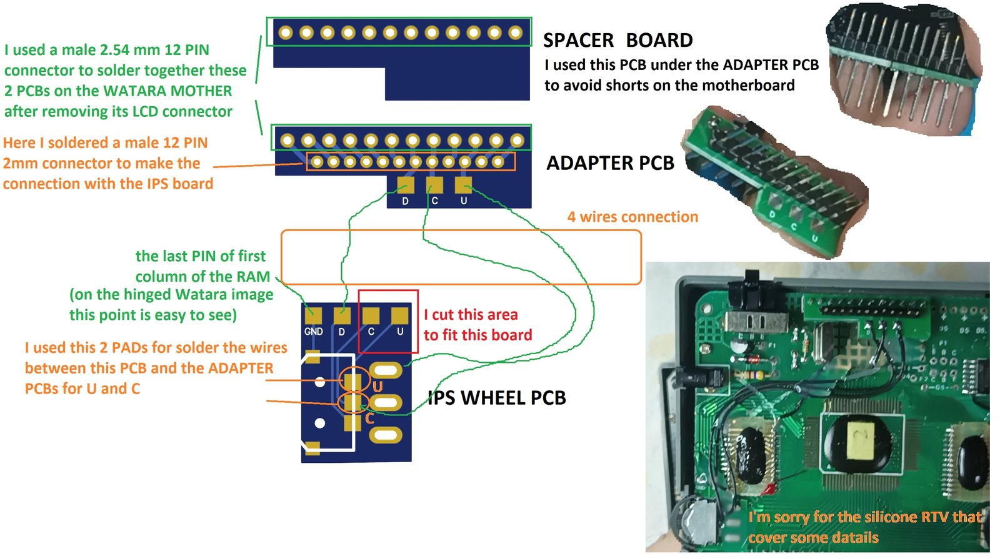

[Back to homepage](README.md)

# Board preparation: Unhinged version
Components to desolder (**required step**):

 
Components to be refreshed (**optional step**). As you can see in the following image, I have also desoldered the LCD connector (it is needed for the last step).

Final step: solder the IPS wheel PCB (and the 4 wires as shown). The result is not as clean as on the hinged version, but this way the same IPS wheel PCB and IPS PCB can be reused.

[Back to homepage](README.md)
