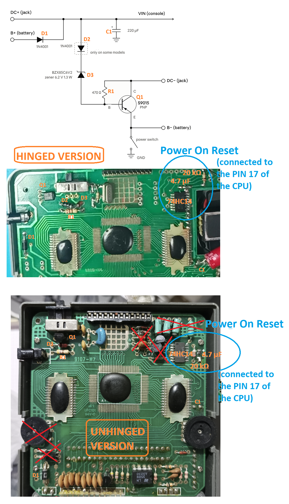

[Back to homepage](README.md)

# Motherboard information and fixes

If you have a faulty Watara and plan to fix it while installing the IPS screen from this repo, you can first remove all the circuitry for the OEM screen (as explained in the [Board preparation](Board_preparation_hinged.md) section). Then you can repair the power circuit using the schematic shown below.

The image below shows the console's power circuit, without the parts required only by the OEM screen. This means you can fix it (usually by replacing just a few components) without the screen connected, simply checking that the console boots by listening to the sound.

**Power adapter and Q1**

The IPS screen draws more current than the OEM screen, so Q1 must be replaced with an **SS8550** if you want to use a power adapter. Check the pinout of your SS8550 before soldering it: it is usually E-B-C (flat side facing you, leads down), like the original S9015, but some variants have a different pin order. I use a generic 6 V / 1 A power adapter with a center-negative pin (the same type used by the Game Boy DMG). I don't think the original power adapter can supply enough current (I don't have one to test), but you need at least 0.5 A to stay within a safe range.

**Other parts**

If needed, you can also replace the volume potentiometer and the audio jack (part numbers are listed in the [BOM](BOM.md) section).

**Notes**

- The Watara only turns on if a game is inserted, so clean the cartridge slot with isopropyl alcohol (IPA) as well.
- If you have trouble booting games, the power-on reset circuit (also highlighted in the image) needs to be fixed by replacing just 3 components. Its output is connected to **pin 17** of the CPU (in [Kevtris](http://blog.kevtris.org/blogfiles/Supervision_Tech.txt)' notes this pin is mistakenly labeled as "clock out?").
- Never touch the COB (chip-on-board) ICs: they are very fragile.

 

[Back to homepage](README.md)
