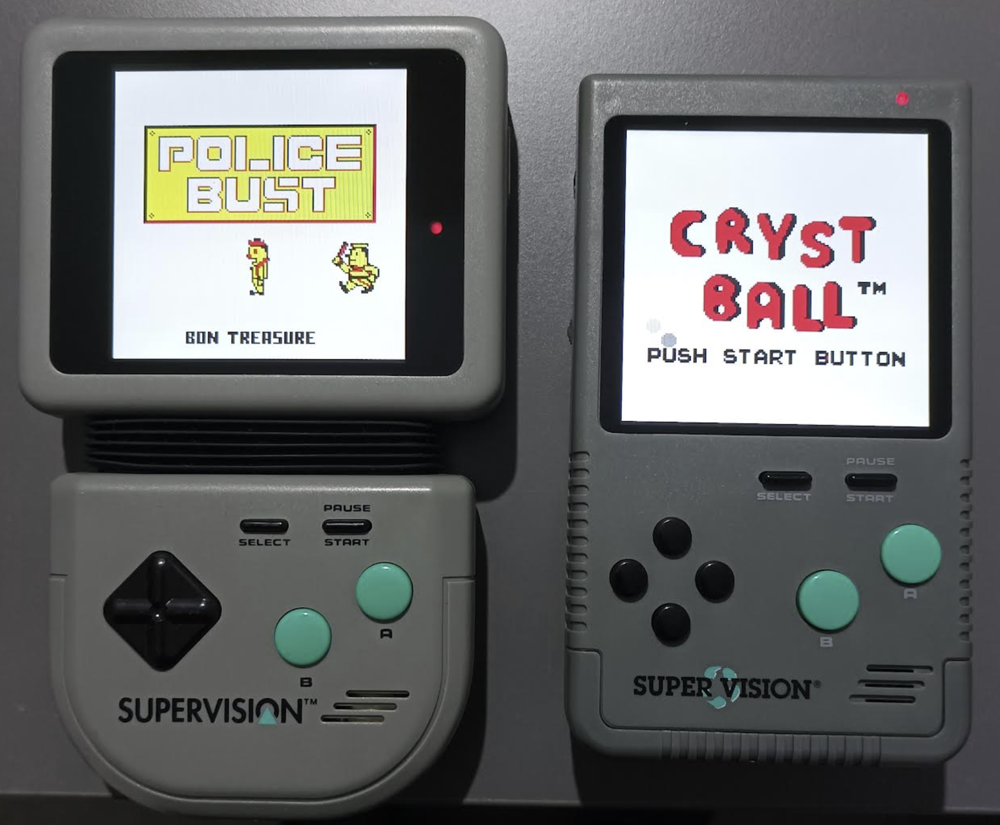
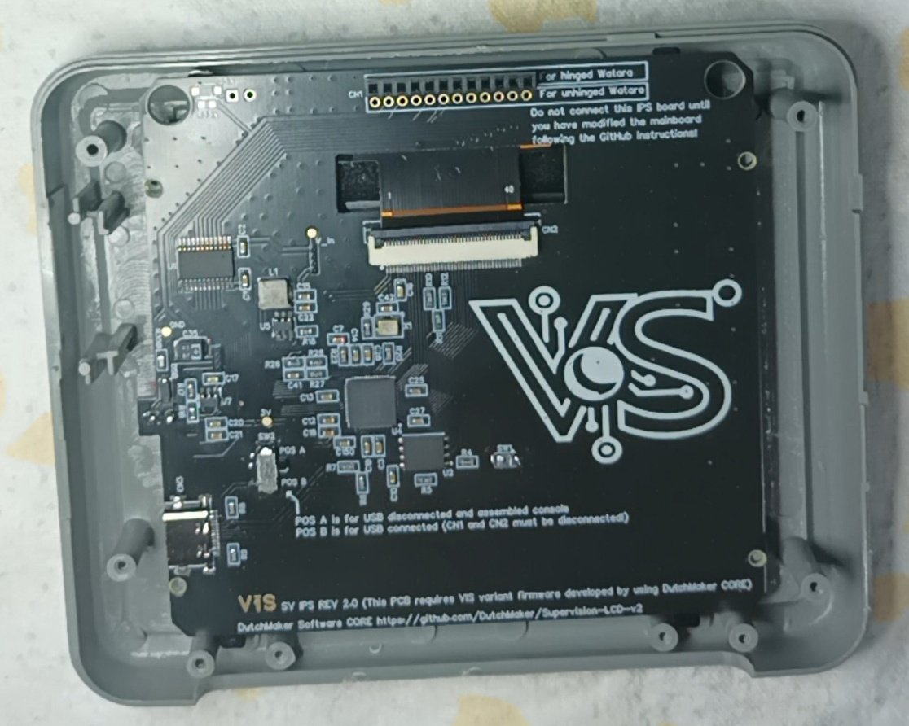
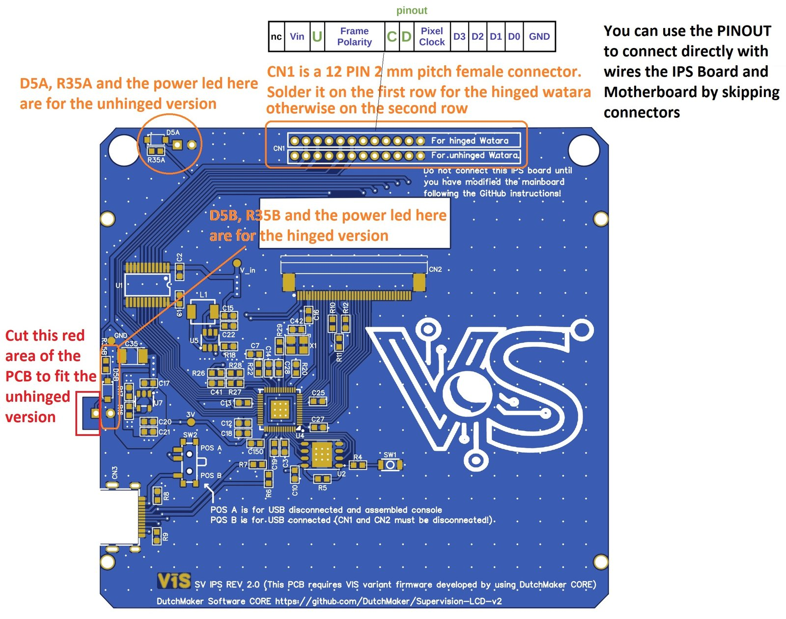
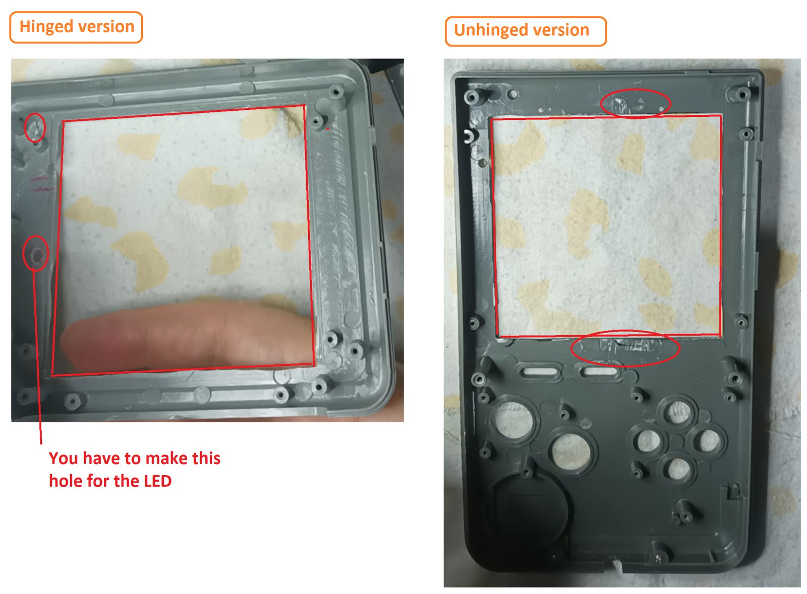
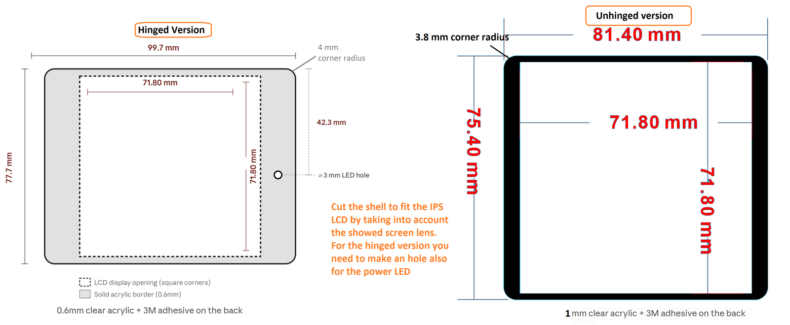

# Watara Supervision IPS LCD MOD

 

A drop-in upgrade that replaces the Watara Supervision's original screen with a modern IPS panel. Designed for the hinged model, where it fits perfectly, it also works with the rarer unhinged model thanks to a rough adaptation, so the same IPS board can be used for both versions. This work is an extension of the incredible work by [DutchMaker](https://github.com/DutchMaker/Supervision-LCD-v2), who created the open-source firmware based on the Raspberry Pi Pico.

The result is simply a Watara Supervision with an IPS screen, where I cut out all the circuitry related to the original screen.

By ordering a pre-assembled IPS board from PCBWay, the project only requires basic soldering skills.

 

## Disclaimer

**This is a DIY project for electronics enthusiasts. For this reason, I am not responsible for any damage incurred while attempting this project or after completion of the project. You alone accept all risk since you are 100% liable for damage to yourself or your property.**

## Instructions

1. Prepare the mainboard and add the IPS wheel board to it ([Hinged version tutorial](Board_preparation_hinged.md) or [Unhinged version tutorial](Board_preparation_unhinged.md)).
   If your console is faulty, take a look at the [Motherboard information and fixes](Motherboard_information.md) page: it explains how to repair the power circuit and which parts to replace (including Q1, which **must** be replaced to use a power adapter with the IPS screen).
2. Populate the IPS board yourself, or order it already assembled from PCBWay (BOM and links below).

   

3. Program the Pico on the IPS board (explained below).
4. Cut the shell for the new LCD.

   

5. Order or make your own screen lens (you can refer to the following image), then 3D print the LCD bracket.

   

6. Assemble the console.

Watch the YouTube video below to better understand each step.

## YouTube video for the setup

[Link_here](https://youtu.be/CA8IZA4ixjw)

## Bill of Materials (BOM)

[List here](BOM.md).

## LCD Firmware Features

Compared to the original firmware released by [DutchMaker](https://github.com/DutchMaker/Supervision-LCD-v2), several new display-related features have been added (see the [VIS variant firmware](VIS_variant_firmware/README.md) page for details).

- **Palette menu:** hold the center button of the IPS wheel for more than half a second to open the on-screen menu. Scroll with UP/DOWN: the palette is previewed live on the game screen. A short press confirms, while a long press (or 8 seconds without input) closes the menu and restores the previous palette. 25 palettes are included (Game Boy, Game Boy Color, Super Game Boy and some popular community palettes).
- **Brightness:** outside of the menu, the UP and DOWN buttons adjust the display backlight brightness on the fly, with an on-screen level bar.
- **Automatic save:** the selected palette and the backlight level are saved automatically into persistent memory (when a palette is confirmed, and 3 seconds after the last brightness change). A short "SAVED" message confirms it. While saving, the image may pause for a fraction of a second: this is normal.

## Production

The [Bracket_and_gerbers_files](Bracket_and_gerbers_files) folder contains the STL file for the 3D-printed LCD bracket and the Gerber files for the IPS wheel board (0.8 mm thickness).
If you plan to use the mod on the unhinged version, you also need to produce the SPACER (0.8 mm thickness) and ADAPTER (1.2 mm thickness) PCBs.

The main IPS board (the one with the RP2040) is **not** included as Gerber files in this repository: it is available only as a shared project on PCBWay, where you can order it bare or pre-assembled:

## Minimal Instructions to Program the Pico

- Compile the firmware in the [VIS_variant_firmware](VIS_variant_firmware) folder to obtain the UF2 file. To set up the Raspberry Pi Pico SDK and the build environment, follow the instructions in the [DutchMaker](https://github.com/DutchMaker/Supervision-LCD-v2) repository.
- Populate the IPS PCB.
- With nothing connected to the IPS PCB, set switch SW2 to position B, then hold down SW1 while connecting the IPS board to a computer with a USB cable. A virtual drive will appear on your computer, and you can release SW1. Copy the UF2 file onto the drive: once the copy is complete, the drive disconnects automatically. Then unplug the USB cable from the IPS board.
- Finally, set SW2 to position A and connect the LCD to the Supervision mainboard to test your soldering.

## Credits

- [DutchMaker](https://github.com/DutchMaker/Supervision-LCD-v2) for creating the open-source firmware used to drive the IPS LCD on the Watara Supervision.

- [Tobi](https://www.embedded-ideas.de/posts/250417_open_dmg_display/) (creator of the Open DMG Display / ODD project) for all the support during the development of this project, especially on LCD backlight management.

- [Kevtris](http://blog.kevtris.org/blogfiles/Supervision_Tech.txt) for the Supervision reverse engineering notes, which were extremely useful during the development process.

## License

Copyright (C) 2026 VISMODDING

This project is licensed under the Creative Commons
Attribution-NonCommercial-ShareAlike 4.0 International License
(CC BY-NC-SA 4.0). See the [LICENSE](LICENSE) file for details.

The firmware is a modified version of DutchMaker's firmware and is therefore covered by his [NON-COMMERCIAL USE LICENSE](https://github.com/DutchMaker/Supervision-LCD-v2/blob/main/LICENSE).

### Additional permission

As the copyright holder, vismodding grants DutchMaker (Ruud van Falier, DutchMaker.nl) and Modding Marius permission to produce and sell boards based on this design, in addition to the rights granted by the CC BY-NC-SA 4.0 license.

This additional permission covers only the hardware design and documentation in this repository. It does not grant any rights to DutchMaker's firmware: any commercial use of the firmware requires the permission of its author.

### Why non-commercial?

Unlike my other mods, this one is very easy to build, so it would also be easy for someone to turn it into a business. I chose a non-commercial license to keep this project free for the community and to prevent others from profiting from it.
