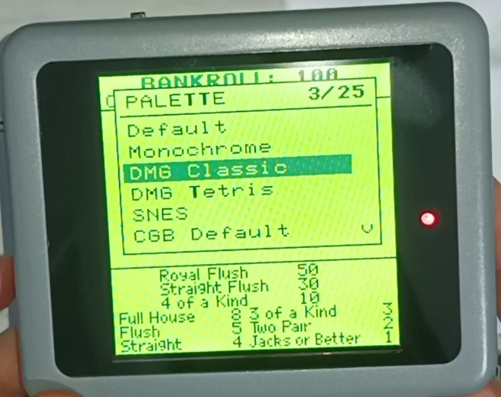

[⬅️ Back to Main](../README.md)

## 🛠️ DutchMaker VIS Variant Firmware

This firmware is a customized version of the **[Original DutchMaker Project](https://github.com/DutchMaker/Supervision-LCD-v2)**. 

> [!IMPORTANT]
> **A huge thank you to DutchMaker** for his incredible work and for sharing the original source code with the community. Without his foundation, this project wouldn't have been possible.

This specific fork has been adapted for the **VIS hardware variant**, introducing key improvements to the core synchronization logic and a new physical user interface.

> [!NOTE]
> **Disclaimer:** As I am not an expert in firmware development, I utilized AI tools (Gemini, ChatGPT and Claude by Anthropic) to assist in writing the code, debugging synchronization issues, and drafting this documentation. This is an updated version (see the changelog below) of the firmware of my previous project (reboard for the unhinged watara version) published [here](https://github.com/VISmodding/Watara-Supervision-Lipo-built-in-reboard-IPS-screen). This update was developed with Claude and tested on real hardware. This version of the firmware can be used also with my reboard previous project.

### ⚡ Critical Fixes & Improvements
* **Multi-Core Sync Fix (Volatile Qualifier):** In the original implementation, the `sync` flag (shared between Core 0 for capture and Core 1 for rendering) lacked the `volatile` qualifier. This caused the compiler to cache the variable in registers, preventing the render core from seeing updates from the capture core. 
    * **Result:** Fixed the "stuck on splash screen" issue, ensuring reliable cross-core communication.
* **Render Startup Optimization:** Improved the `render_core()` initialization by forcing `sync = 1` after the first frame. This ensures the render loop activates immediately and stays perfectly in phase with the capture hardware.
* **Safe Settings Save:** Saving settings to flash no longer freezes the system. The save buffer was moved off the small Core 1 stack (2 KB), and Core 0 is now safely paused (multicore lockout) while the flash sector is erased and written.
    * **Result:** Settings can be saved at any time while playing; at most a few frames are skipped.
* **Physical UI (Thumbwheel):** Added support for a 3-way navigation switch (Up/Down/Click) to manage:
    * **Brightness:** Real-time PWM backlight control with an on-screen level bar.
    * **Palette Switching:** On-screen menu with live preview, position counter and scroll arrows.
    * **Automatic Save:** Settings are saved automatically when a palette is confirmed and 3 seconds after the last brightness change (only if something changed, to limit flash wear). A "SAVED" popup confirms each save.

| Action | Outside the menu | Inside the menu |
| :--- | :--- | :--- |
| **Up / Down** | Brightness up / down | Scroll palettes (live preview) |
| **Short press** | – | Confirm palette and save |
| **Long press (> 0.5 s)** | Open palette menu | Cancel and restore previous palette |



### 📝 Changelog

* **Freeze on save fixed:** the 4 KB flash buffer no longer overflows the 2 KB Core 1 stack, and Core 0 is paused with `multicore_lockout` while the flash is erased and written.
* **Automatic save:** the double-click save was removed. Settings are now saved automatically when a palette is confirmed and 3 seconds after the last brightness change, only if something actually changed. A "SAVED" popup confirms each save.
* **New palette menu:** title, position counter (e.g. "9/25"), scroll arrows and **live preview** while scrolling. A long press, or 8 seconds without input, cancels and restores the previous palette.
* **Brightness bar:** a 9-step bar is shown on screen while adjusting the backlight.
* **New brightness range:** the three brightest levels were removed because they drew too much current and made the battery voltage drop (the console's low battery indicator turned on). Three dimmer levels were added instead. Default level: 7 of 9.
* **25 palettes:** added GB Pocket, GB Light, Kirokaze, Ice Cream, Mist, Blk Aqua and Virtual Boy, plus CGB Brown, CGB Red and CGB Dark Brown to complete the Game Boy Color set.
* **Font:** added the missing uppercase "Q".

### 📜 License & Building
This project follows the **same license** as the original DutchMaker repository. 

To respect the original author's work and ensure hardware compatibility, **pre-compiled binaries (.uf2) are not provided.** You must compile the firmware yourself:

1. Setup the **Raspberry Pi Pico SDK**.
2. Clone this repository.
3. Follow the standard `cmake` and `make` workflow.

> [!IMPORTANT]
> For detailed build instructions, please refer to the [Original DutchMaker Documentation](https://github.com/DutchMaker/Supervision-LCD-v2).

---

### 📺 LCD Interface (8-Bit Parallel)
Since the data pins are mapped in reverse order (**D0 → GPIO7** through **D7 → GPIO0**) to simplify PCB routing, the firmware includes a fast bit-reversal function. If you are using this firmware on different hardware, you may need to adjust the `reverse_bits()` function in `lcd.c`.


| Signal | Pin (GPIO) | Notes |
| :--- | :---: | :--- |
| **LCD_D0** | 7 | Inverted Mapping |
| **LCD_D1** | 6 | |
| **LCD_D2** | 5 | |
| **LCD_D3** | 4 | |
| **LCD_D4** | 3 | |
| **LCD_D5** | 2 | |
| **LCD_D6** | 1 | |
| **LCD_D7** | 0 | |
| **LCD_RD** | 8 | Read Signal (Active Low) |
| **LCD_WR** | 9 | Write Signal (Pulse) |
| **LCD_DC** | 10 | Data / Command Select |
| **LCD_CS** | 11 | Chip Select |
| **LCD_RST**| 12 | Hardware Reset |

### 🎮 Console Supervision Signals
Dedicated pins for capturing raw video data and synchronization signals from the original console hardware.

| Signal | Pin (GPIO) | Notes |
| :--- | :---: | :--- |
| **DATA 0** | 22 | |
| **DATA 1** | 21 | |
| **DATA 2** | 20 | |
| **DATA 3** | 19 | |
| **P_CLOCK**| 18 | Pixel Clock |
| **F_POL** | 17 | Frame Polarity |

### 🛠️ User Interface & Control
| Signal | Pin (GPIO) | Notes |
| :--- | :---: | :--- |
| **BACKLIGHT**| 16 | PWM Brightness Control |
| **WHEEL_UP** | 25 | Navigation (Internal Pull-up) |
| **WHEEL_MID**| 24 | Menu Select / Click |
| **WHEEL_DWN**| 23 | Navigation (Internal Pull-up) |

---

## 🎨 Custom Color Palettes

The firmware includes a wide variety of color profiles to enhance the retro-gaming experience. You can cycle through them using the **3-way thumbwheel** (hold the center button to open the menu, Up/Down to scroll with live preview, short press to apply).

### Built-in Palettes
The following profiles are already available in `lib/palette.c` but if you want to create your own color scheme, you can modify the `palettes` array in `lib/palette.c` before compiling:

```c
static const pal_t palettes[] = {
    {"Default",        {0xB0CB65, 0x607623, 0x415115, 0x1A2108}},
    {"Monochrome",     {0xD2D2D2, 0xAAAAAA, 0x555555, 0x000000}},
    {"DMG Classic",    {0x9BBC0F, 0x8BAC0F, 0x306230, 0x0F380F}},
    {"DMG Tetris",     {0xFFFFFF, 0xFFFF00, 0xFF0000, 0x000000}},
    {"SNES",           {0xF7E7C6, 0xD68E49, 0xA63725, 0x331E50}},
    {"CGB Default",    {0xFFFFB5, 0x7BFF31, 0x00AD52, 0x000000}},
    {"GB Pocket",      {0xC4CFA1, 0x8B956D, 0x4D533C, 0x1F1F1F}},
    {"GB Light",       {0x00B581, 0x009A71, 0x00694A, 0x004F3B}},
    {"Kirokaze",       {0xE2F3E4, 0x94E344, 0x46878F, 0x332C50}},
    {"Ice Cream",      {0xFFF6D3, 0xF9A875, 0xEB6B6F, 0x7C3F58}},
    {"Mist",           {0xC4F0C2, 0x5AB9A8, 0x1E606E, 0x2D1B00}},
    {"Blk Aqua",       {0x9FF4E5, 0x00B9BE, 0x005F8C, 0x002B59}},
    {"Virtual Boy",    {0x000000, 0x550000, 0xA40000, 0xEF0000}},
    {"CGB Blue",       {0xFFFFFF, 0x63A5FF, 0x0000FF, 0x000000}},
    {"CGB Dark Blue",  {0xFFFFFF, 0x8C8CDE, 0x52528C, 0x000000}},
    {"CGB Gray",       {0xFFFFFF, 0xA5A5A5, 0x525252, 0x000000}},
    {"CGB Pastel",     {0xFFFFA5, 0xFF9494, 0x9494FF, 0x000000}},
    {"CGB Orange",     {0xFFFFFF, 0xFFFF00, 0xFF0000, 0x000000}},
    {"CGB Yellow",     {0xFFFFFF, 0xFFFF00, 0x7B4A00, 0x000000}},
    {"CGB Green",      {0xFFFFFF, 0x52FF00, 0xFF4200, 0x000000}},
    {"CGB Dark Green", {0xFFFFFF, 0x7BFF31, 0x0063C5, 0x000000}},
    {"CGB Inverted",   {0x000000, 0x008484, 0xFFDE00, 0xFFFFFF}},
    {"CGB Brown",      {0xFFFFFF, 0xFFAD63, 0x843100, 0x000000}},
    {"CGB Red",        {0xFFFFFF, 0xFF8484, 0x943A3A, 0x000000}},
    {"CGB Dark Brown", {0xFFE6C5, 0xCE9C84, 0x846B29, 0x5A3108}},
};

```
Each palette is composed of 4 colors in HEX (RGB888) format. The firmware will automatically handle the conversion for the display.
Take a look [here](https://tcrf.net/Notes:Game_Boy_Color_Bootstrap_ROM#Assigned_Palette_Configurations) to see the Game Boy Color palettes used here. The community palettes (GB Pocket, Kirokaze, Ice Cream, Mist, Blk Aqua) come from [Lospec](https://lospec.com/palette-list).

[⬅️ Back to Main](../README.md)
